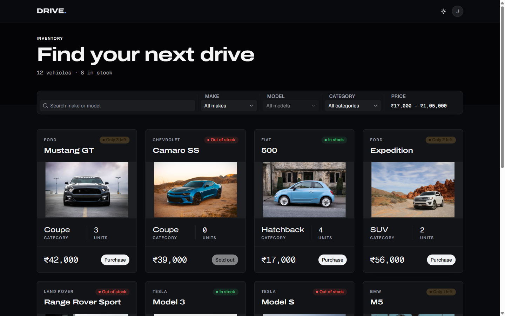
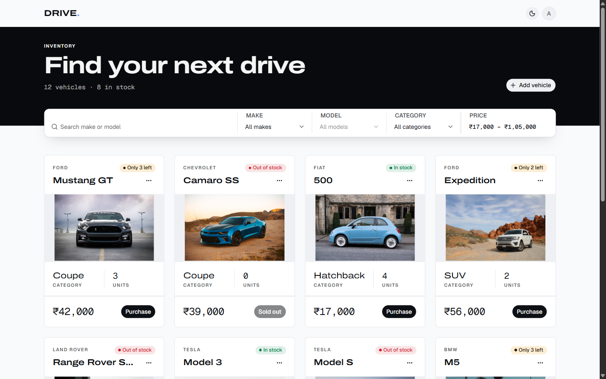
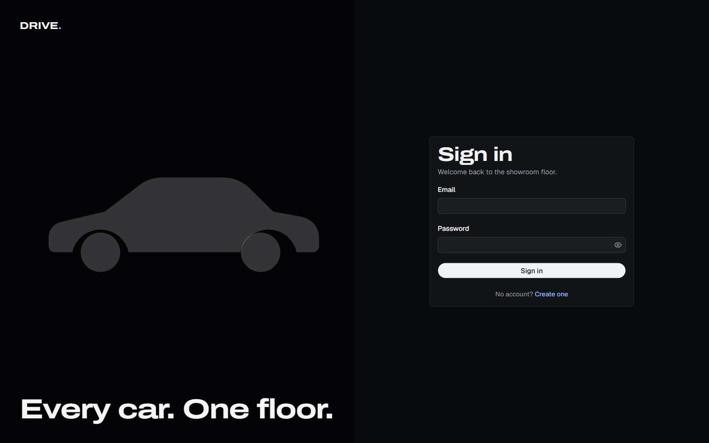
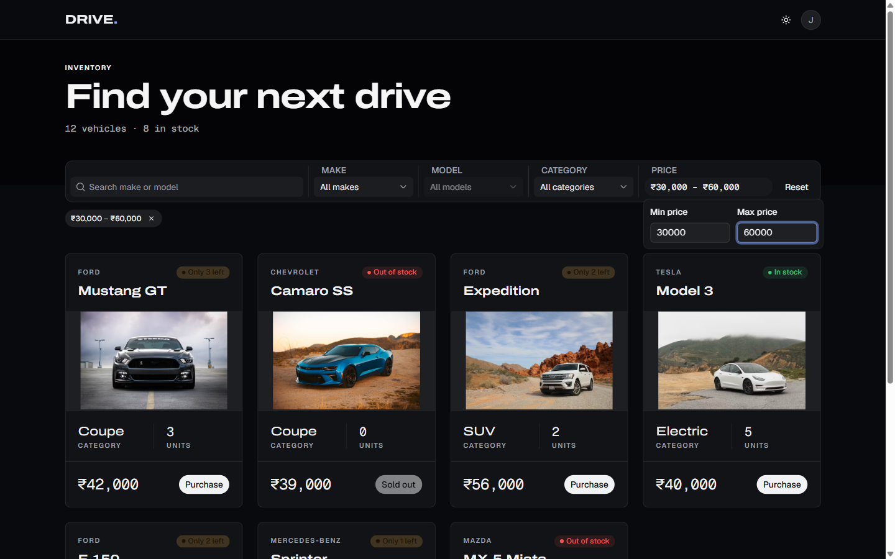
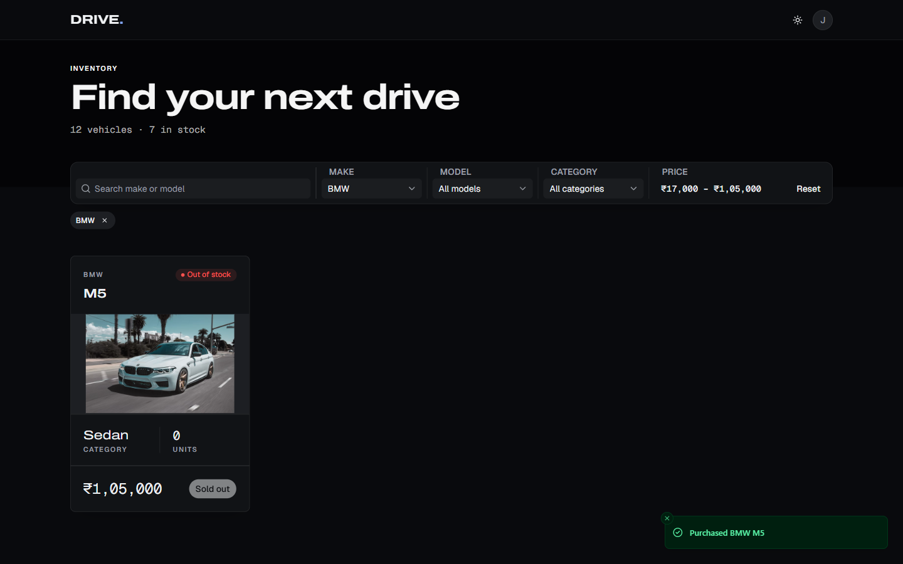
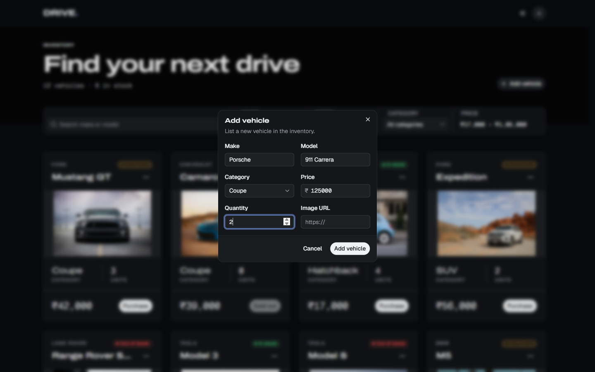
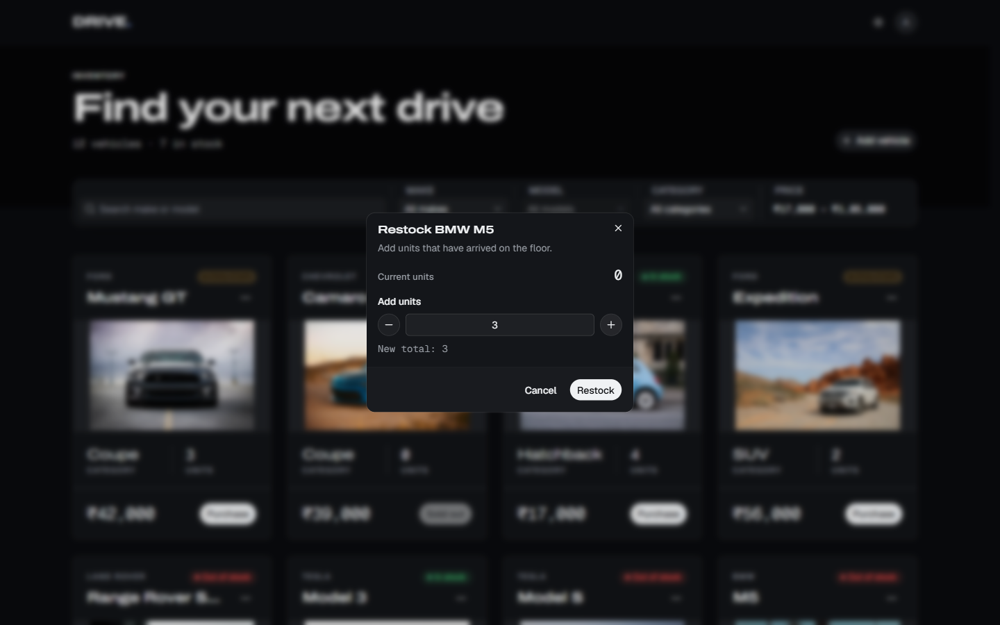
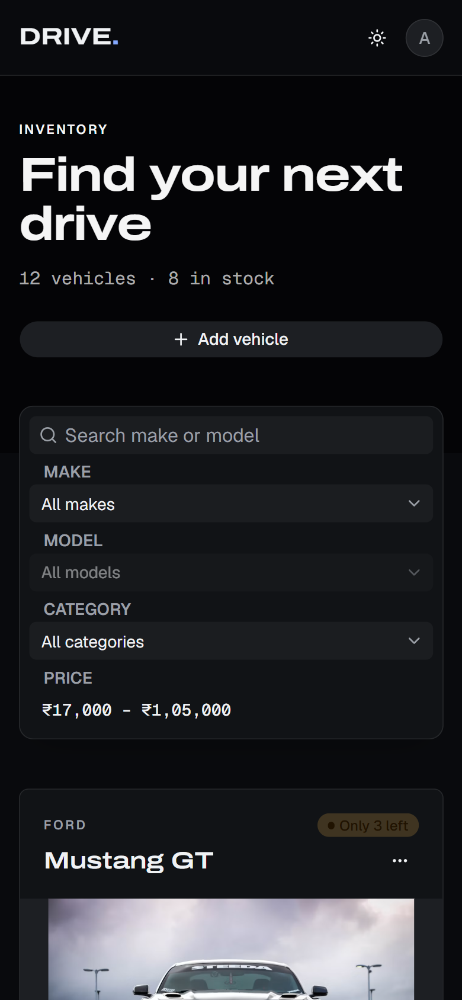

# DRIVE. Car Dealership Inventory System

A full-stack inventory system for a car dealership. Customers register, browse the showroom, search and filter vehicles, and buy them. Admins add, edit, restock and delete vehicles. Stock can never go below zero, even when many people buy the last car at the same moment.

The project was built as a TDD kata: every behaviour went through a red, green, refactor cycle, and the commit history shows each step.

- **Live app:** <https://incubyte-oa-frontend.vercel.app>
- **AI prompt logs:** [PROMPTS.md](PROMPTS.md)
- **Full screenshot walkthrough:** [WALKTHROUGH.md](WALKTHROUGH.md)

## Contents

- [Features](#features)
- [Screenshots](#screenshots)
- [Tech stack](#tech-stack)
- [Project structure](#project-structure)
- [Running locally](#running-locally)
- [Scripts](#scripts)
- [API overview](#api-overview)
- [Test report](#test-report)
- [My AI Usage](#my-ai-usage)
- [Design decisions](#design-decisions)
- [API documentation](#api-documentation)
- [Deploy](#deploy)

## Features

**For everyone (signed in)**

- Register and sign in with email and password. Sessions use a short-lived JWT.
- Browse every vehicle with its make, model, category, price, stock level and photo.
- Search by make or model, and filter by make, model, category and price range. Filters live in the URL, so a filtered view can be bookmarked or shared.
- Buy a vehicle in one click. The button is disabled when stock is zero, and the card shows "In stock", "Only N left" or "Out of stock".
- Light and dark themes, a responsive layout down to phone width, and keyboard-accessible controls.

**For admins**

- Add a vehicle, edit its details, restock it, or delete it. Admin controls are hidden from regular users, and the API rejects their requests with 403 anyway.
- Admin accounts are never created through the UI. `db:seed` creates or resets the admin with a fresh random password.

**Under the hood**

- Purchase and restock are single atomic SQL updates (`quantity = quantity - 1 WHERE quantity >= 1`) backed by a `CHECK (quantity >= 0)` constraint. A test fires parallel purchases at the real database and checks that exactly the available stock is sold.
- Every request and response is validated with shared Zod schemas, which also generate the OpenAPI document.
- Every error uses one shape: `{ "error": { "code", "message", "details" } }`.

## Screenshots

Highlights only. The [walkthrough](WALKTHROUGH.md) covers the whole flow step by step.

| Inventory (dark theme) | Inventory (light theme, admin) |
| --- | --- |
|  |  |

| Sign in | Search and filters |
| --- | --- |
|  |  |

| Purchase, last unit sold | Admin: add vehicle |
| --- | --- |
|  |  |

| Admin: restock | Mobile |
| --- | --- |
|  |  |

## Tech stack

| Area | Tools |
| --- | --- |
| Monorepo | pnpm workspaces, TypeScript, Node 22 |
| API (`apps/api`) | Express 5, Drizzle ORM, PostgreSQL 17 (Docker locally, Neon in production), Zod, `jose` (JWT), `bcryptjs`, helmet, CORS, Scalar API reference |
| Web (`apps/web`) | React 19, React Router, Vite, Tailwind CSS v4, shadcn/ui, React Hook Form, Sonner |
| Shared (`packages/shared`) | Zod schemas and inferred types for every request and response |
| Testing | Vitest, Supertest (against a real Postgres test database), React Testing Library, user-event, MSW |
| Quality | Biome (lint and format), oxlint with `@shadcn/lint` (web only), lefthook pre-commit hooks, GitHub Actions CI |
| Hosting | Vercel (API as a function, SPA as a static site) |

## Project structure

```
apps/
  api/                 Express API
    src/
      routes/          paths and middleware wiring
      controllers/     HTTP in, HTTP out; no business logic
      services/        business rules; no Express, no SQL
      repositories/    Drizzle queries behind interfaces
      middleware/      authenticate, requireRole, validate, errorHandler
      db/              schema, migrations, client, seed
      config/env.ts    the only place that reads process.env
      container.ts     wires repositories -> services -> controllers
    test/              Vitest + Supertest suites
  web/                 React SPA
    src/
      api/             typed API client (parses responses with shared schemas)
      auth/            session, token storage, route guard
      inventory/       inventory grid, filters, purchase, admin dialogs
      pages/           login, register, dashboard
    test/              RTL + MSW suites
packages/
  shared/              Zod schemas shared by api and web
compose.yaml           Postgres for development (5432) and tests (5433)
```

## Running locally

### Prerequisites

- **Node.js 22** (see `.nvmrc`; `>=22.9` is required)
- **pnpm 11** (`corepack enable` picks up the version pinned in `package.json`)
- **Docker** with Docker Compose, for the two Postgres databases

### 1. Install dependencies

```bash
git clone https://github.com/pranavgnn/incubyte-oa.git
cd incubyte-oa
pnpm install
```

### 2. Start the databases

```bash
docker compose up -d
```

This starts two Postgres 17 containers: `db` on port **5432** for development and `db-test` on port **5433** for the test suites. The test database lives in memory and is wiped when the container stops.

### 3. Configure the backend

```bash
cp apps/api/.env.example apps/api/.env
```

Open `apps/api/.env` and set `JWT_SECRET` to a random string of at least 32 characters. You can generate one with:

```bash
node -e "console.log(require('crypto').randomBytes(48).toString('base64url'))"
```

The other defaults already match `compose.yaml`. The API refuses to start, with a message naming the bad keys, if any variable is missing or invalid.

| Variable | Purpose |
| --- | --- |
| `NODE_ENV` | `development`, `test` or `production` |
| `PORT` | API port, default `3000` |
| `DATABASE_URL` | Development database |
| `TEST_DATABASE_URL` | Test database; must differ from `DATABASE_URL` because tests truncate it |
| `JWT_SECRET` | Signing key for JWTs, at least 32 characters |
| `JWT_EXPIRES_IN` | Token lifetime, default `15m` |
| `WEB_ORIGIN` | Origin allowed by CORS, default `http://localhost:5173` |
| `ADMIN_EMAIL` | Email of the admin account that `db:seed` creates or resets |

### 4. Create the schema and seed data

```bash
pnpm --filter api db:migrate
pnpm --filter api db:seed
```

The seed creates (or resets) the admin account and prints its credentials **once** in the terminal. Copy the password then; it is not stored anywhere. Running the seed again generates a new password. On an empty database it also adds 12 sample vehicles across every category, some sold out and some low on stock.

### 5. Configure the frontend

```bash
cp apps/web/.env.example apps/web/.env
```

`VITE_API_URL` defaults to `http://localhost:3000`, the local API.

### 6. Run the app

```bash
pnpm dev
```

This starts both apps in parallel:

- **Web app:** <http://localhost:5173>
- **API:** <http://localhost:3000> (health check at <http://localhost:3000/api/health>, API reference at <http://localhost:3000/api/docs>)

Register a new account to shop as a regular user, or sign in with the seeded admin credentials to manage inventory.

To run one side only:

```bash
pnpm --filter api dev    # backend only
pnpm --filter web dev    # frontend only
```

### 7. Run the tests

```bash
pnpm test                # all suites
pnpm test:coverage       # all suites with coverage thresholds enforced
```

The API suites run against the `db-test` container, so keep `docker compose up -d` running. Vitest's global setup migrates the test database before the run and every test starts from truncated tables.

## Scripts

| Command | What it does |
| --- | --- |
| `pnpm dev` | Runs the API (`tsx watch`) and the web app (Vite) together |
| `pnpm test` | Runs every test suite |
| `pnpm test:coverage` | Runs every suite with coverage and fails below the thresholds |
| `pnpm --filter api test:report` | Writes a JUnit report to `apps/api/reports/junit.xml` |
| `pnpm lint` | Biome check across the repo |
| `pnpm --filter web lint` | oxlint design-system rules for the web app |
| `pnpm typecheck` | `tsc --noEmit` in every package |
| `pnpm build` | Builds the API bundle and the web app |
| `pnpm --filter api db:generate` | Generates a Drizzle migration from schema changes |
| `pnpm --filter api db:migrate` | Applies migrations to `DATABASE_URL` |
| `pnpm --filter api db:seed` | Creates or resets the admin and seeds sample vehicles |

## API overview

All routes are under `/api`. The interactive reference at `/api/docs` has full request and response schemas.

| Method | Path | Access | Description |
| --- | --- | --- | --- |
| `GET` | `/api/health` | Public | Checks the API and the database |
| `POST` | `/api/auth/register` | Public | Creates a user account and returns a token |
| `POST` | `/api/auth/login` | Public | Returns a token for valid credentials |
| `GET` | `/api/auth/me` | Signed in | Returns the current user |
| `GET` | `/api/vehicles` | Signed in | Lists all vehicles |
| `GET` | `/api/vehicles/search` | Signed in | Filters by `q`, `make`, `model`, `category`, `minPrice`, `maxPrice` |
| `POST` | `/api/vehicles` | Admin | Adds a vehicle |
| `PUT` | `/api/vehicles/:id` | Admin | Updates a vehicle's details (not its stock) |
| `DELETE` | `/api/vehicles/:id` | Admin | Deletes a vehicle |
| `POST` | `/api/vehicles/:id/purchase` | Signed in | Buys one unit; 409 `OUT_OF_STOCK` at zero |
| `POST` | `/api/vehicles/:id/restock` | Admin | Adds 1 to 1000 units |
| `GET` | `/api/openapi.json` | Public | OpenAPI 3.1 document |
| `GET` | `/api/docs` | Public | Interactive API reference |

## Test report

Results from `pnpm test:coverage` on this branch: **317 tests in 41 files, all passing**. The API suites run against a real Postgres database; nothing in the data layer is mocked.

### Summary

| Package | Test files | Tests | Passed | Failed | Skipped |
| --- | --- | --- | --- | --- | --- |
| `apps/api` | 25 | 175 | 175 | 0 | 0 |
| `apps/web` | 16 | 142 | 142 | 0 | 0 |
| **Total** | **41** | **317** | **317** | **0** | **0** |

### Coverage

| Package | Statements | Branches | Functions | Lines | Thresholds |
| --- | --- | --- | --- | --- | --- |
| `apps/api` | 99.32% | 97.36% | 100% | 99.28% | 90% (85% branches) |
| `apps/web` | 94.62% | 87.59% | 94.88% | 95.94% | 80% |

<details>
<summary>API test files (175 tests)</summary>

| File | Tests |
| --- | --- |
| `test/config/env-schema.test.ts` | 7 |
| `test/config/test-database-url.test.ts` | 3 |
| `test/container.test.ts` | 1 |
| `test/db/client.test.ts` | 2 |
| `test/db/seed-admin.test.ts` | 5 |
| `test/db/seed-vehicles.test.ts` | 3 |
| `test/db/vehicles-schema.test.ts` | 2 |
| `test/middleware/require-role.test.ts` | 3 |
| `test/routes/auth-login.test.ts` | 13 |
| `test/routes/auth-me.test.ts` | 14 |
| `test/routes/auth-register.test.ts` | 13 |
| `test/routes/docs.test.ts` | 2 |
| `test/routes/error-handling.test.ts` | 3 |
| `test/routes/health.test.ts` | 2 |
| `test/routes/security.test.ts` | 3 |
| `test/routes/vehicles-create.test.ts` | 21 |
| `test/routes/vehicles-delete.test.ts` | 5 |
| `test/routes/vehicles-list.test.ts` | 3 |
| `test/routes/vehicles-purchase-concurrency.test.ts` | 1 |
| `test/routes/vehicles-purchase.test.ts` | 10 |
| `test/routes/vehicles-restock.test.ts` | 14 |
| `test/routes/vehicles-search.test.ts` | 26 |
| `test/routes/vehicles-update.test.ts` | 14 |
| `test/services/auth-service.test.ts` | 1 |
| `test/services/bcrypt-password-hasher.test.ts` | 4 |

</details>

<details>
<summary>Web test files (142 tests)</summary>

| File | Tests |
| --- | --- |
| `test/api/auth-api.test.ts` | 4 |
| `test/api/client.test.ts` | 8 |
| `test/api/form-errors.test.ts` | 4 |
| `test/api/vehicles-api.test.ts` | 12 |
| `test/auth/auth-provider.test.tsx` | 6 |
| `test/auth/safe-next.test.ts` | 10 |
| `test/auth/token-storage.test.ts` | 2 |
| `test/config/env-schema.test.ts` | 3 |
| `test/inventory/vehicle-filters.test.ts` | 20 |
| `test/pages/admin-dialogs.test.tsx` | 27 |
| `test/pages/dashboard-page.test.tsx` | 27 |
| `test/pages/login-page.test.tsx` | 7 |
| `test/pages/register-page.test.tsx` | 5 |
| `test/routing/require-auth.test.tsx` | 2 |
| `test/shell/app-shell.test.tsx` | 2 |
| `test/theme/theme-provider.test.tsx` | 3 |

</details>

To reproduce: `docker compose up -d`, then `pnpm test:coverage`. `pnpm --filter api test:report` writes the API results as JUnit XML to `apps/api/reports/junit.xml`.

## My AI Usage

### Tools

1. Claude Code CLI:
- I used this to code the entire project. My chats are all in PROMPTS.md. Used Opus 5.5 on medium specifically.

2. Claude.ai Web Chat
- I used this to create my CLAUDE.md and DESIGN.md. These chat links are in PROMPTS.md as well. Used Opus 5.5 on medium specifically.

3. Context7 MCP: Forced library docs instead of relying on model's knowledge.

4. @shadcn/lint: Used as a guardrail so that the AI is forced not to deviate from DESIGN.md.

5. Pinterest: Visual references (inspiration / reference images) given to Claude web when creating the DESIGN.md file.

6. Caveman: Skill used to save output tokens.

### How I used them

1. CLAUDE.md is the contract, of course. It has the architecture of the project, the TDD rules, commit rules, skills and mcp usage (caveman skill and Context7 mcp), and codebase rules, like not to touch PROMPTS.md and "AI Usage" section in README.md (this section).

2. Plan mode was used before every session. I read the plans given to me, and if there were things to correct, I corrected. This repeated until I was happy with the plans and gave it the green flag to implement.

3. Optimized git for agentic usage. Made it branch first, then once its done, publish a PR using the gh cli, and I would manually review it. If I was content with it, I would merge to main. I have also set up my GitHub repository to not allow commits to main.

4. Parallel development, as the deadline was approaching, I realized I didn't have enough time, so made a new git worktree for developing frontend in parallel. I had to make it generate a local copy of the API contract for test cases initially, but it all worked out at the end. 

### Where the AI went wrong

1. Claude committed a feat when test was still red, because it checked the output, not exit code. It has been fixed in the next commit.
2. A smoke test revealed that stopping Postgres crashed the API. It would have definitely occurred in production if not caught early. It was fixed test-first.
3. The DESIGN.md had some inconsistencies and was not aligned fully with the backend's schema. Caught it early and fixed it by giving the full API contract.
4. Vercel's zero config deploy would have broken in runtime. This was caught in planning.

### Reflection

Honestly, I have worked with AI a lot on projects, but this was the most intense session. This is because I had never taken a red green refactor approach. For my earlier projects, I always wrote code first, then test cases. In that case, AI would develop a lot faster, so this was frustrating to me as developing just one API route took upwards of an hour. However, towards the end, I realized the importance of red green refactor approach. It caught so many bugs early on, my final manual testing went smooth. I'm starting to believe that red green refactor is the best for AI driven development.

During this development process, I realized that my role from typing code has completely shifted to making decisions and reviewing code critically. The value was in the tech stack I picked, the harness I developed for my AI agent, rather than writing lines of code by hand. 

Also, TDD with AI was slow initially. Even for test runs, bcrypt was computing at cost 12. I made it group related cases into one it.each cycle to only run the affected test file during cycles.

If I were to do this again, I would definitely do the parallel worktree separation right from the start, as it saves a lot of time. Another thing is I would have spent more time on planning the project alone, as in retrospect there's a lot of time I could have saved had I prompted better.


The raw prompt logs are in [PROMPTS.md](PROMPTS.md).


## Design decisions

Places where the implementation is stricter than, or extends, the brief.

- **`GET /api/health` is public.** Deploy checks call it without credentials. It runs `SELECT 1` so a 200 proves the API can reach Postgres, not just that the process is up.
- **`SERVICE_UNAVAILABLE` (503) extends the error code map.** When the database is unreachable, health returns 503 in the standard error shape instead of a generic 500, so "API up, database down" is distinguishable from a crash. The driver's error message is never sent to the client.
- **Password length is capped at 72 UTF-8 bytes, not 72 characters.** bcrypt only uses the first 72 bytes of its input and silently ignores the rest, so a longer password would be accepted but only partly checked at login. Counting bytes means a password of multi-byte characters (e.g. 25 × "€" = 75 bytes) is rejected with 400 instead of being truncated. The minimum stays 8 characters.
- **Login compares a password even when the email is unknown.** An early return for an unknown email would answer in milliseconds while a wrong password takes a full bcrypt comparison, so response time would reveal which emails are registered. The service always calls the hasher, which compares against a dummy hash at its own cost (12 in production) when no user matched and then returns false. Both cases also return the identical 401 `UNAUTHORIZED` "Invalid credentials" body.
- **Login does not apply the register password policy.** The login schema only requires a non-empty password. A password that is too short or over the 72-byte cap is answered with the same 401 "Invalid credentials" as any other wrong password, instead of a 400 that would tell a caller what the policy is.
- **`GET /api/auth/me` extends the brief.** The SPA keeps only the token across page loads, so it needs an endpoint that turns a token back into `{ id, email, role }` to restore the session. It requires a valid bearer token and reads the user from the database rather than echoing the token's claims, so a user deleted after the token was issued gets 401 instead of a ghost session.
- **`requireRole` answers 401, not 403, when there is no identity.** It is meant to run after `authenticate`. If a route were ever wired without `authenticate`, there is no caller to judge, so the route stays closed with 401 `UNAUTHORIZED` instead of passing through or claiming the caller lacks a role. A caller who is authenticated but not an admin gets 403 `FORBIDDEN`.
- **`db:seed` promotes an existing account with `ADMIN_EMAIL`.** The seed upserts on `lower(email)`: it creates the admin, or, if that email already exists (even as a regular user who registered it first), sets the role to `admin` and replaces the password, keeping the same id. A fresh `crypto.randomBytes` password is generated on every run and printed once; it is never stored in plain text or written to a file. `ADMIN_EMAIL` is optional in the env schema because only the seed reads it, and the seed refuses to run without it.
- **The API is prebundled with esbuild instead of relying on Vercel's zero-config Express build.** Zero-config does not bundle: it compiles each `.ts` file with the repo's TypeScript (7.x here) and renames it to `.js`, but `@dealership/shared` exports its raw `./src/index.ts`, so the deployed function would fail to resolve it at runtime. `scripts/build.ts` bundles `src/vercel.ts` into `dist/index.js` (ESM, Node 22), inlining workspace packages and keeping npm dependencies external for Vercel to install and trace. CI builds and smoke-checks the bundle, so a broken bundle fails the pull request instead of the deploy.
- **The Vercel function uses a small pg pool registered with `attachDatabasePool`.** Each Fluid compute instance keeps its own pool (max 5 clients, 5 s idle timeout) in front of Neon's pooled endpoint. `@vercel/functions` keeps the instance alive just long enough for idle clients to close before it suspends, so Neon's scale-to-zero never finds half-open sockets. This is the same failure class as the idle-client crash already handled in `db/client.ts`. The local server keeps pg's defaults.
- **The web app lints design-system rules with oxlint and `@shadcn/lint`, with `no-restyle` off.** No raw colors, no arbitrary values, no inline styles, no unknown Tailwind classes and no dynamically built class strings are errors in `apps/web`. `no-restyle` stays off because DESIGN.md deliberately adds layout and token classes at call sites (for example `max-w-form` on the auth card). The shadcn-generated files in `src/components/ui/**` are exempt from `no-arbitrary-values` only, since they ship values like `ring-[3px]`; every other rule still applies to them.
- **Web coverage excludes the generated shadcn primitives.** `src/components/ui/**` is CLI output, not code written in this repo, so measuring it would reward testing a vendor's components instead of the app. It is excluded along with the `main.tsx` bootstrap; the 80% thresholds apply to everything else in `apps/web/src`.
- **Edit vehicle never sends `quantity`; purchase sends no body.** `PUT /api/vehicles/:id` answers 400 to a `quantity` field because stock only changes through purchase and restock, so the edit dialog shows quantity read-only with that reason and the API client picks only make, model, category, price and image URL for the update. `POST /api/vehicles/:id/purchase` rejects any body field, so the request carries no body and no `Content-Type`. This narrows DESIGN.md's "send the full editable payload" to the fields the API actually lets an update change.
- **A vehicle image can be replaced but not removed in the UI.** The shared update schema accepts `imageUrl: null` to remove an image, but the edit dialog never sends it: clearing the field on a vehicle that has an image is an inline error, and a vehicle without one simply leaves `imageUrl` out. A new https URL replaces the image.
- **The price filter is two whole-number inputs, not a slider.** Empty means no bound, and the placeholders show the cheapest and dearest vehicle in the full list. A bound is sent as soon as it is typed (debounced 300 ms), so `minPrice`/`maxPrice` mean exactly what the user entered. A minimum above the maximum is shown as an inline error and is never sent.
- **Filter params from the URL are validated before use.** Each param is parsed on its own with Zod: blank values, unknown categories, non-integer or negative prices, and a `model` without a `make` are dropped instead of being forwarded to the API. A hand-edited or stale link therefore still loads, with only the bad filter ignored.
- **After sign-in the app only follows a same-origin `next`.** `/login?next=…` comes from the URL, so anyone can craft a link with `next=https://evil.example`. Only values that start with a single `/` are followed; absolute, protocol-relative (`//host`) and backslash (`/\host`) forms fall back to `/`, so the login page cannot be used as an open redirect.
- **Creating and updating vehicles is admin-only.** The brief only names delete and restock as admin actions. Letting any signed-in user add listings or change prices would let a customer edit the catalogue they buy from, so `POST /api/vehicles` and `PUT /api/vehicles/:id` also sit behind `requireRole("admin")`. Regular users get 403 `FORBIDDEN`.
- **Vehicle price and quantity are capped at the int32 maximum (2,147,483,647).** Both are Postgres `integer` columns. Without the cap a larger number would pass validation and fail inside the database as a 500; with it the client gets a 400 `VALIDATION_ERROR` naming the field. Price must be a positive whole number of currency units; quantity may be 0 so sold-out stock stays listed.
- **`PUT /api/vehicles/:id` cannot change `quantity`.** Stock only moves through `POST /:id/purchase` and `POST /:id/restock`, which are single atomic `UPDATE … SET quantity = quantity ± n` statements. An edit that set quantity to an absolute value could silently overwrite a purchase that landed between the admin loading the form and saving it. The update schema is strict, so sending `quantity` is a 400. `imageUrl: null` clears the picture.
- **Vehicle ids are validated as UUIDs, and an update must change something.** A malformed `:id` is a 400 `VALIDATION_ERROR` on `details[].path = ["id"]` instead of reaching Postgres, where the uuid cast would fail as a 500; a well-formed id with no row is a 404. An empty `PUT` body is a 400 rather than a no-op that bumps `updatedAt`.
- **A purchase buys exactly one unit and takes no body fields.** The brief does not say how many units a purchase takes. One per request keeps the atomic update simple and matches a "Buy" button. The body may be omitted or `{}`; a body with any field, such as `{ "quantity": 2 }`, is a 400 so a client never believes it bought more than it did. Admins can purchase too; the route only needs authentication.
- **A single restock adds at most 1000 units.** `POST /api/vehicles/:id/restock` takes `{ "quantity": n }` with `n` a whole number from 1 to 1000. The upper bound catches a mistyped extra zero before it floods inventory; larger deliveries take more than one call.
- **`db:seed` also loads 12 sample vehicles, but only into an empty table.** Every category appears, some at quantity 0 and some at 1 to 3, so a fresh database shows sold-out and low-stock states straight away. If any vehicle exists the step is skipped, so re-running the seed to reset the admin password never duplicates or overwrites real inventory. Image URLs are Unsplash photos that were each checked to load; the truck, van and convertible samples have no image because no verified photo matched them.
- **The OpenAPI spec is generated from the shared Zod schemas and served publicly at `GET /api/openapi.json`.** The brief does not ask for API docs. Writing the spec by hand would let it drift from what the `validate` middleware enforces, so `src/docs/openapi.ts` builds it at startup with Zod 4's built-in `z.toJSONSchema()`, which already emits the JSON Schema 2020-12 dialect OpenAPI 3.1 uses; no zod-to-openapi library is needed. Request schemas are converted in input mode (what the client sends before trimming or coercion), responses in output mode. Refinements JSON Schema cannot express, such as the 72-byte password cap and `minPrice <= maxPrice`, are stated in operation descriptions. The route needs no auth because the spec only describes contracts that are already public in the SPA bundle, and a test validates the document and checks that it lists every route path.
- **`GET /api/docs` is public and is the only route with a relaxed Content Security Policy.** It renders the spec with Scalar (`@scalar/express-api-reference`), whose page loads a script bundle from jsDelivr and runs an inline bootstrap script, both of which helmet's default `script-src 'self'` blocks. Instead of loosening the global policy, the docs route sets its own: each response gets a fresh random nonce, and only script tags carrying it may run, so no other inline script is allowed. It also allows `https:` images. Every other route keeps helmet's default policy. The Scalar bundle is pinned to an exact version so the page cannot change when Scalar publishes.

## API documentation

The API serves an interactive reference generated from the shared Zod schemas, so it always matches what the server validates:

- **Reference (Scalar):** [`http://localhost:3000/api/docs`](http://localhost:3000/api/docs) locally, or `/api/docs` on the deployed API.
- **OpenAPI 3.1 document:** [`http://localhost:3000/api/openapi.json`](http://localhost:3000/api/openapi.json) locally, or `/api/openapi.json` on the deployed API. Import it into Postman, Insomnia or a client generator.

Both are public. To try protected routes from the reference, get a token from `POST /api/auth/login` and paste it into the bearer auth field.

## Deploy

The API deploys to Vercel as one Express function from `apps/api` (project Root Directory). `apps/api/vercel.json` sets the Express preset, runs `pnpm build` to produce `dist/index.js`, and pins the function to `sin1` (Singapore), the same AWS region as the Neon database, to keep query latency low. Migrations and the admin seed run from a local machine against Neon's direct (unpooled) connection string: `pnpm --filter api db:migrate` and `pnpm --filter api db:seed`.
