# Walkthrough

A step-by-step tour of the DRIVE. dealership app, captured from a local run (`pnpm dev`) against a freshly seeded database. It follows one customer from sign-up to purchase, then an admin managing inventory.

Back to the [README](README.md).

## Contents

1. [Signing in and registering](#1-signing-in-and-registering)
2. [Browsing the inventory](#2-browsing-the-inventory)
3. [Searching and filtering](#3-searching-and-filtering)
4. [Buying a vehicle](#4-buying-a-vehicle)
5. [Admin: signing in](#5-admin-signing-in)
6. [Admin: restocking](#6-admin-restocking)
7. [Admin: adding a vehicle](#7-admin-adding-a-vehicle)
8. [Admin: editing and deleting](#8-admin-editing-and-deleting)
9. [Themes, mobile and API docs](#9-themes-mobile-and-api-docs)

## 1. Signing in and registering

Every page except sign-in and registration needs an account, so a signed-out visitor lands on the sign-in page.

Submitting an empty form shows inline errors under each field. The inputs are validated with the same Zod schemas the API uses.

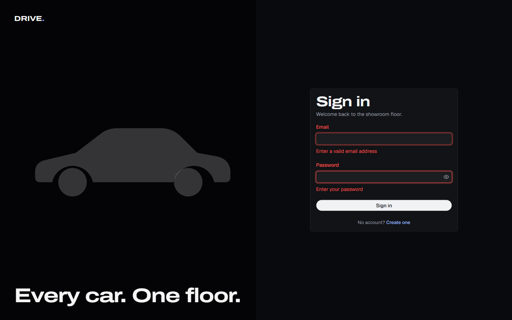

"Create one" opens registration. The password must be 8 characters to 72 bytes, and the confirmation must match. New accounts are always regular users.

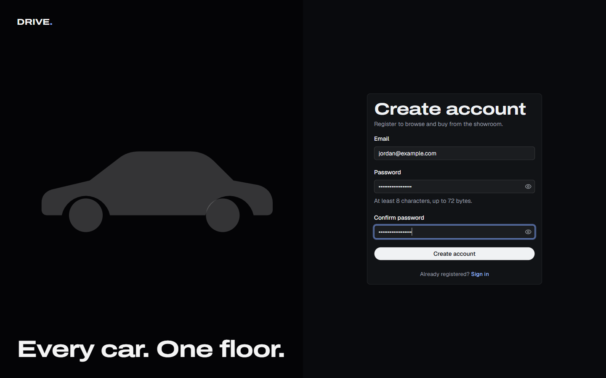

## 2. Browsing the inventory

After registering, the user is signed in and taken straight to the inventory. The header counts all vehicles and those in stock. Each card shows the make, model, category, units and price, with a stock badge: green "In stock", amber "Only N left" or red "Out of stock".

The whole seeded inventory: 12 vehicles across every category. Sold-out vehicles stay listed with a disabled "Sold out" button, and vehicles without a photo show a silhouette.

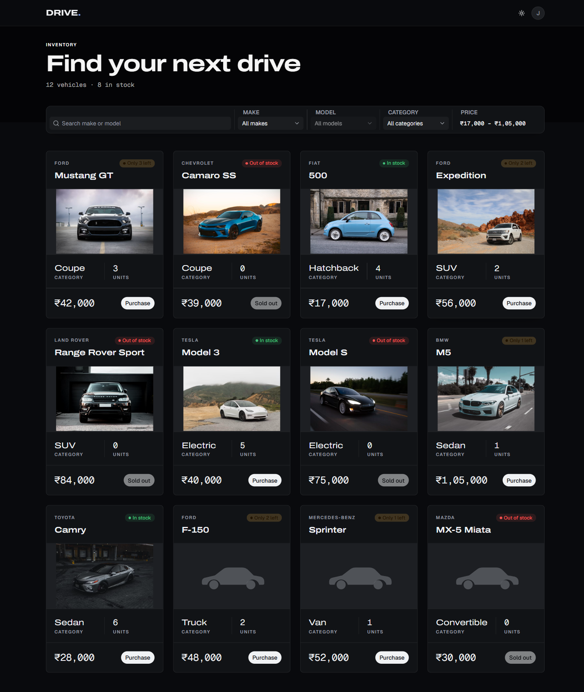

## 3. Searching and filtering

Typing in the search box matches make or model, case-insensitively. The active filter appears as a removable chip, and the URL updates (`/?q=ford`) so the view can be shared.

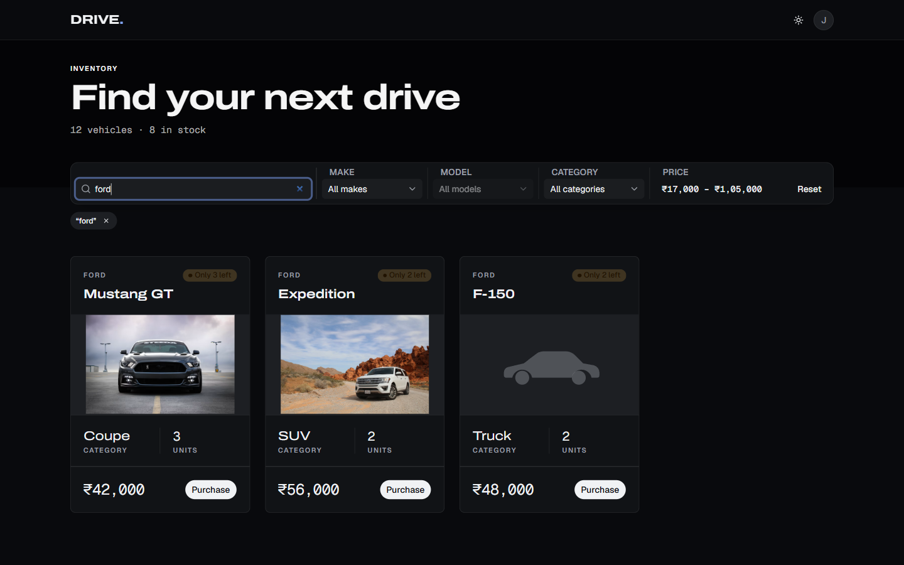

Filtering by category narrows the grid to electric vehicles.

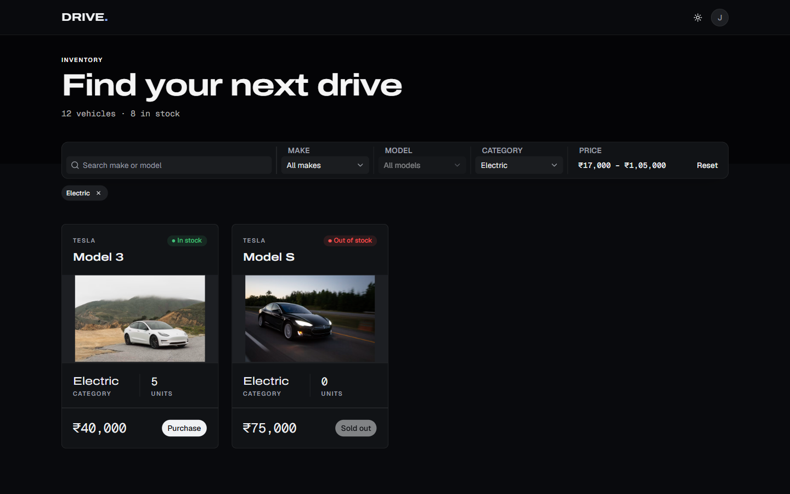

The price filter takes a minimum and a maximum in whole rupees. The placeholders show the cheapest and dearest price in the full list.

When nothing matches, an empty state offers to clear the filters.

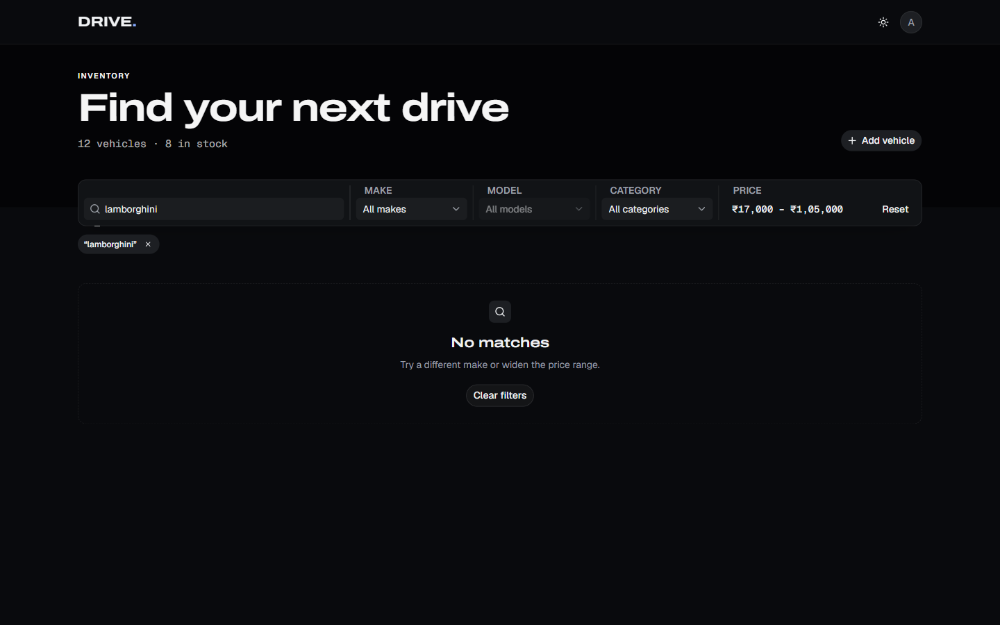

## 4. Buying a vehicle

"Purchase" buys one unit. Here the user buys the last BMW M5: a toast confirms it, the units drop to 0, the badge turns to "Out of stock" and the button becomes a disabled "Sold out". The in-stock count in the header drops from 8 to 7.

## 5. Admin: signing in

The user signs out from the account menu. A wrong password gives the same generic error whether or not the email exists, so the form never reveals which accounts are registered.

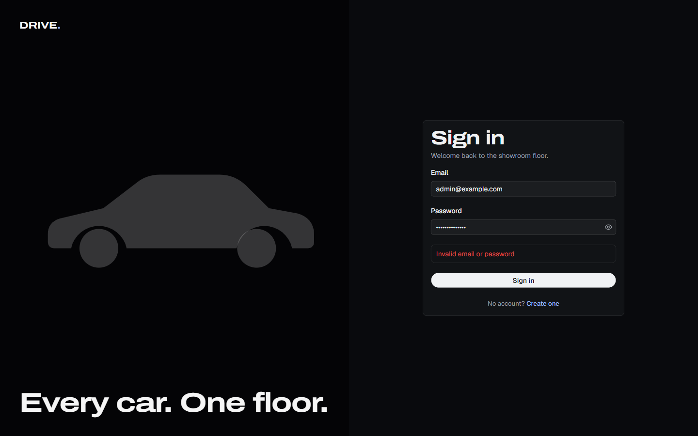

With the credentials printed by `pnpm --filter api db:seed`, the admin sees an "Add vehicle" button and an actions menu on every card. Regular users never see these, and the API answers 403 if they try.

Each card's actions menu has Edit, Restock and Delete.

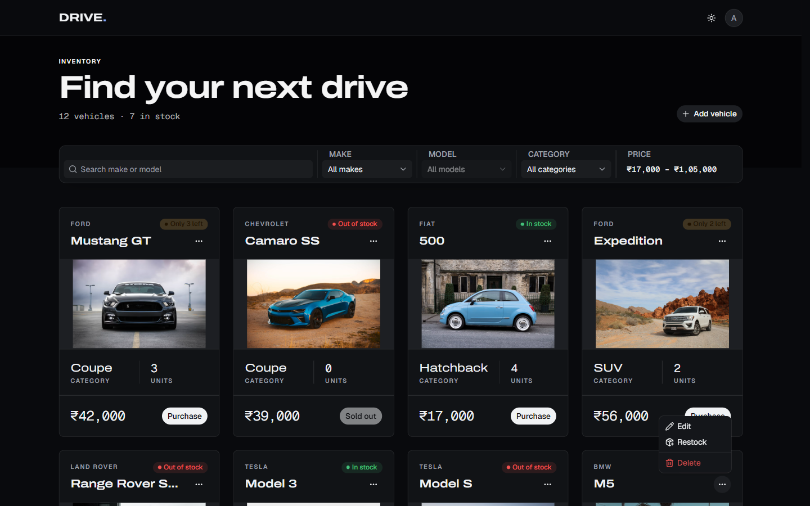

## 6. Admin: restocking

Restock adds units to the current stock. The dialog shows the current count and the new total. A single restock adds 1 to 1000 units.

After restocking, the M5 is back to "Only 3 left" and can be bought again.

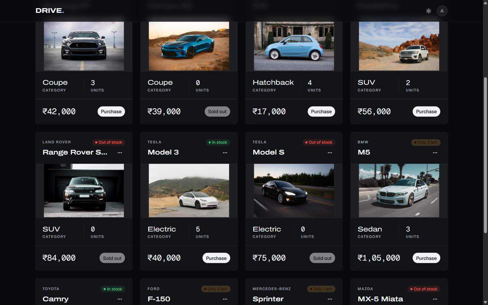

## 7. Admin: adding a vehicle

"Add vehicle" opens a form for make, model, category, price, starting quantity and an optional https image URL. Submitting it empty shows what is missing.

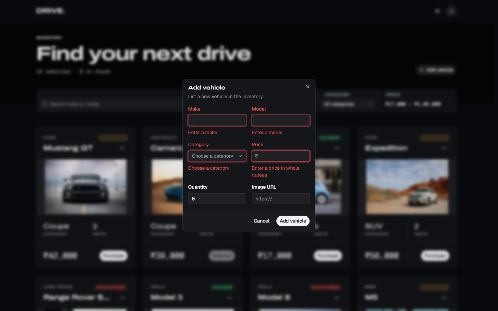

The filled-in form for a Porsche 911 Carrera.

The new vehicle appears at the top of the grid. Without an image URL it shows the silhouette.

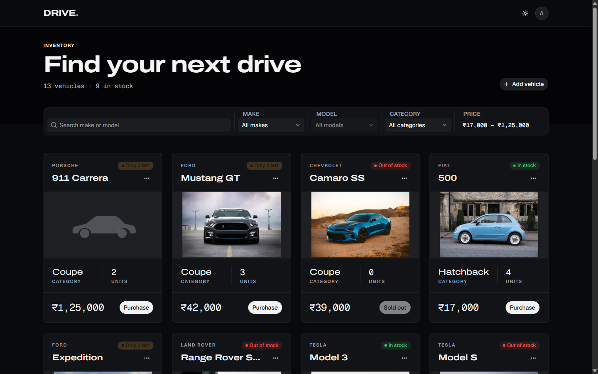

## 8. Admin: editing and deleting

Edit changes the details but not the stock. Quantity is read-only here because stock only changes through purchase and restock, so an edit can never overwrite a purchase that happened in the meantime. "Save changes" stays disabled until something changes.

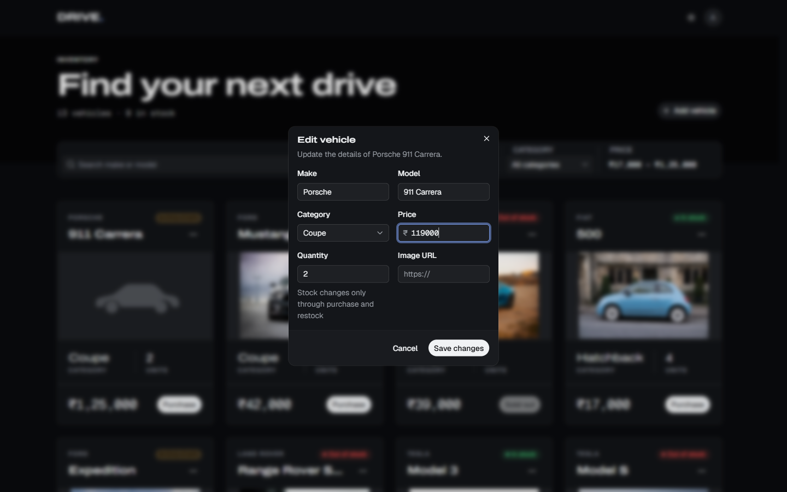

Delete asks for confirmation first, because it cannot be undone.

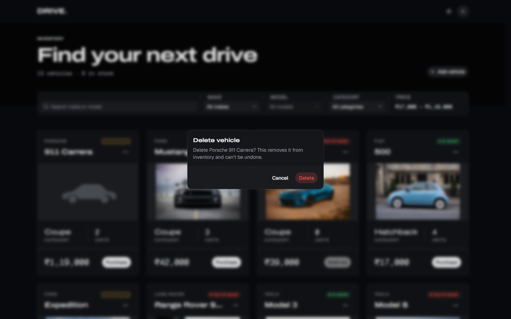

## 9. Themes, mobile and API docs

The sun and moon button in the header switches between dark and light themes.

On a phone-sized screen the filters stack and the cards fill the width.

The API serves an interactive reference at `/api/docs`, generated from the shared Zod schemas.

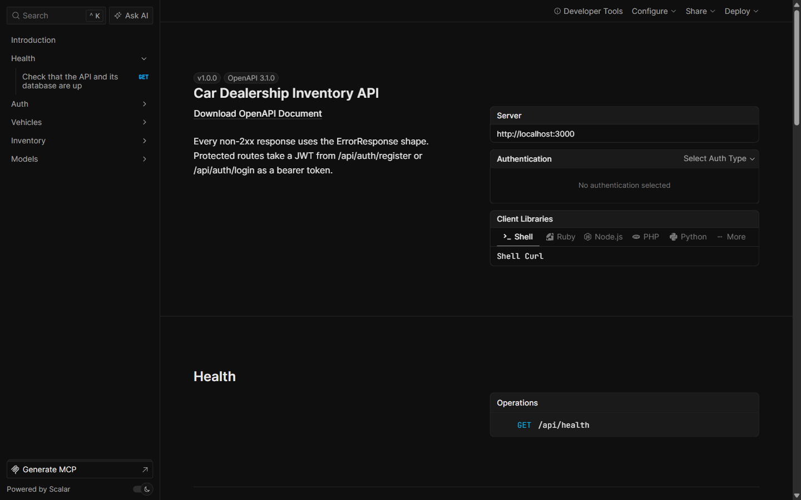
